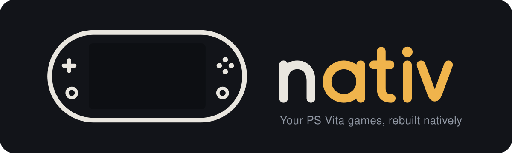

# Project Nativ

Project Nativ turns PS Vita games into native programs for macOS, Linux and Windows. You bring your own copy of a
game. The tools recompile it on your machine, and it runs like any other program, with extras the Vita never had:
higher resolutions, wider screens, 60 fps and mouse aiming, depending on the game.

The name is "native" with the Vita inside it, spelled backwards: n·ATIV.

## How it works

A Vita game is ARM code written against Sony's system software. Nativ handles the two separately.

- **The game's code is recompiled.** A static recompiler translates the game's ARMv7 code, Thumb-2, VFP and NEON
  included, into C once, ahead of time. That C is compiled into a native program.
- **The system underneath is rebuilt.** Sony's own libraries that a game loads, such as libgxm, libc and FIOS, are
  recompiled with it from your firmware. Below them, a runtime stands in for the Vita's kernel and hardware: it runs
  the game's threads, draws its graphics on your GPU and plays its sound.

[How it works](docs/architecture.md) goes into the design.

## Nothing of the game ships

This repository holds no game code, game data or firmware, and nothing we distribute ever will. You supply your own
copy of each game and Sony's firmware update file, and the tools decrypt and recompile them on your machine.

## Supported games

| Game | Release | Title ID | Versions |
|---|---|---|---|
| Killzone: Mercenary | US | PCSA00107 | 1.00, 1.12 (recommended: Botzone and online play) |
| Uncharted: Golden Abyss | US | PCSA00029 | 1.00 |
| Unit 13 | US | PCSA00014 | 1.00 |
| Shovel Knight | US | PCSE00640 | 1.00 |

Each game's pack supports exact releases, recognised by the SHA-256 of the game's main program. Game-specific fixes,
such as Killzone's physics fix or the widescreen cameras, patch code at fixed addresses, so they only fit the build
they were written for. Your game data doesn't need to match; the main program does.

Not supported yet: other regions (EU, JP, Asia) and the later updates of Uncharted (1.03), Unit 13 (1.01) and Shovel
Knight (1.08, Treasure Trove). The launcher recognises them and tells you which release it supports. It keeps an
unsupported update, and the game runs without it. Porting a new release starts with `dev/hookmap.py`, which carried
43 of Killzone 1.12's 46 hooks over from 1.00 by matching code.

## Getting started

**Players** use the launcher. It walks you through first-run setup, then builds and starts your games. Build it with
`launcher/build.sh`; the result is `launcher/nativ`.

**Developers** can run each stage of the pipeline with `./vitarecomp` from the top of the checkout. Run it without
arguments for the full list. The main stages, in order:

| Command | What it does |
|---|---|
| `firmware <PUP>` | Decrypts Sony's firmware update file. |
| `scan <folder>` | Finds games, updates and firmware files in a folder, at any depth. |
| `add <copy>` | Adds a game or its update. `import` takes one that's already decrypted. |
| `analyze <title>` | Finds the game's functions. |
| `recompile <title>` | Translates them to C. |
| `build <title>` | Compiles the game. |
| `run <title>` | Plays it. |
| `check <titles>` | Runs the regression gate. |

The pipeline's Python needs the packages in `requirements.txt`, installed in `.venv` at the top of the checkout
(`python/` on Windows).

### Your library

Your games, firmware, licences, builds and saves live in one library folder:

- `dump/` inside a checkout, which git ignores;
- otherwise your per-user data folder: `~/Library/Application Support/ProjectNativ/Nativ/library` on macOS, under
  `~/.local/share` on Linux and under `%LOCALAPPDATA%` on Windows;
- or wherever `ATIV_DUMP` points.

### Installing

`./vitarecomp dist <folder>` writes an install that holds only what ships. Running it again over an install it wrote
updates the program and leaves your library alone. Two scripts add what a player's machine lacks:

- **Linux:** `dev/linux-install.sh <folder>` adds its own compiler and Python, for machines like the Steam Deck that
  have neither.
- **macOS:** `dev/macos-install.sh <folder>` adds SDL, SPIRV-Cross, FFmpeg's H.264 decoder and Python, and a
  `Project Nativ.app` to start it. The player needs only Apple's Command Line Tools, which the app offers to install.
  Build the libraries once with `runtime/platform/macos/setup-toolchain.sh`.

The [player guide](docs/player-guide.md) covers the rest from the player's side: first run, controls, online play and
reporting a bug.

## Repository layout

| Folder | What's in it |
|---|---|
| `launcher/` | The launcher (`hub.cpp`): your library, first-run setup and settings. It runs the pipeline for you. |
| `pipeline/` | The `vitarecomp` driver, plus game and licence handling. |
| `recompiler/` | The static recompiler, its runtime header `rt.h`, and seeds for functions the analysis misses. |
| `runtime/` | What a recompiled game runs on: `core/` (kernel and libraries), `gfx/` (graphics), `audio/`, `media/`, `input/`, `net/` (networking and online play), `ui/` (window and in-game menu), `platform/`, `debug/` and `tests/`. `build.py` builds it. |
| `packs/<title>/` | One folder per game: `pack.toml` (versions, modules, hooks and settings), `hooks.c` (that game's code patches) and `shaders.txt` (its shader recipes). |
| `decrypt/` | Decrypting firmware updates and game packages, converting SELF to ELF, and the table of Sony's function names. |
| `servers/` | Killzone's login server stand-in (`kzserver/`) and the relay node for online play (`nativ-node/`). |
| `dev/` | Developer tools: replays, diffs and bisects, the remote gate, tests and firmware research. |
| `third_party/` | Dear ImGui, stb, LibAtrac9, Monocypher and the HE-VAG tables, each with its licence. |
| `docs/` | The documentation listed below. |
| `assets/brand/` | The logo, wordmark and app icons, all drawn from one geometry by `make.py`. |

## Documentation

- [Player guide](docs/player-guide.md): installing, first run, controls, online play, known issues and bug reports.
- [How it works](docs/architecture.md): the design, layer by layer.
- [Working on Nativ](docs/developers.md): the pipeline, packs and versions, and working across machines.
- [The runtime in detail](docs/runtime.md): display timing, audio, the GPU backend, controls, hooks and metrics.
- [Verification](docs/verification.md): the regression gate and how the translation and renderer are checked.
- [Debugging a game](docs/debugging.md): logs, captures, replays and the renderer's switches.
- [Online play](docs/online.md): matchmaking, finding other players, and the encrypted links between them.
- [The shader compiler](docs/shader-compiler.md) and [the USSE instruction set](docs/usse-isa.md): the Vita's GPU
  shaders and how we translate them.

## Licence

Project Nativ is free software under the GNU General Public License, version 2 or (at your option) any later version:
see [LICENSE](LICENSE). Third-party code keeps its own licence, and [THIRD_PARTY.md](THIRD_PARTY.md) lists it with
the projects parts of Nativ are ported from.

Nativ contains no Sony or game code. You supply your own games and the firmware from Sony's site; the games are
recompiled on your machine and never leave it.
